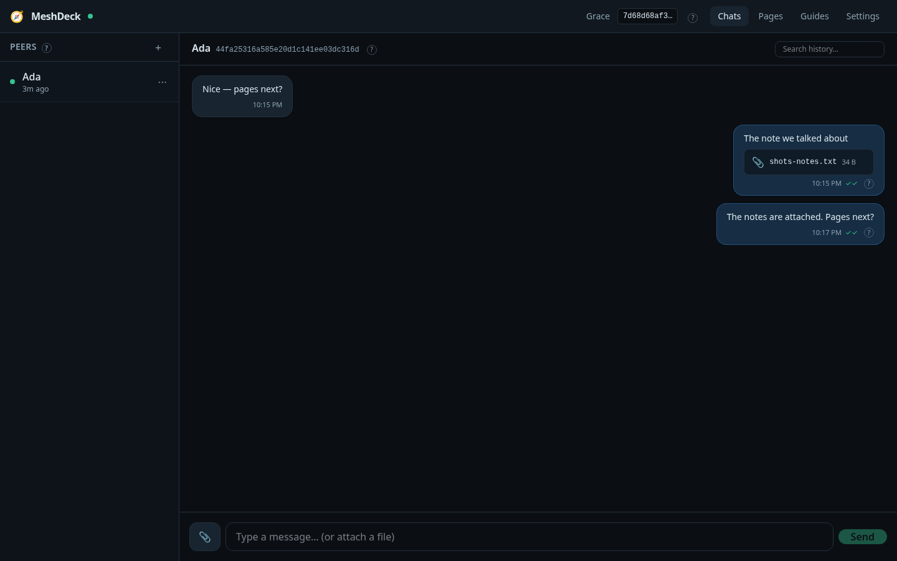
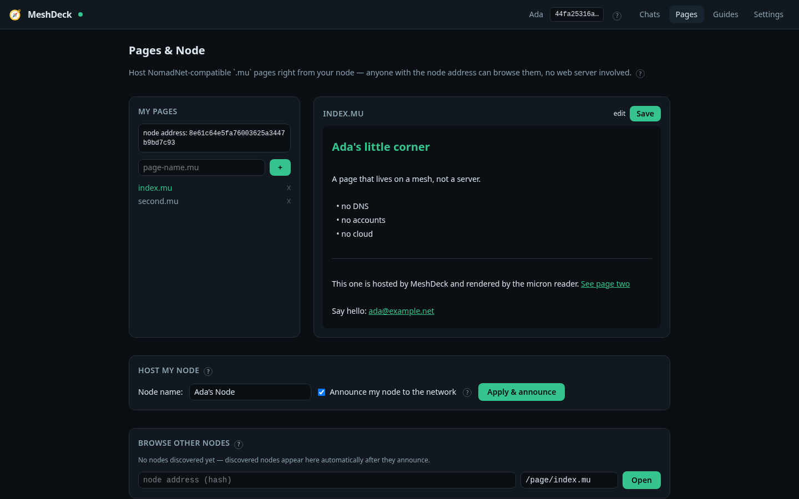
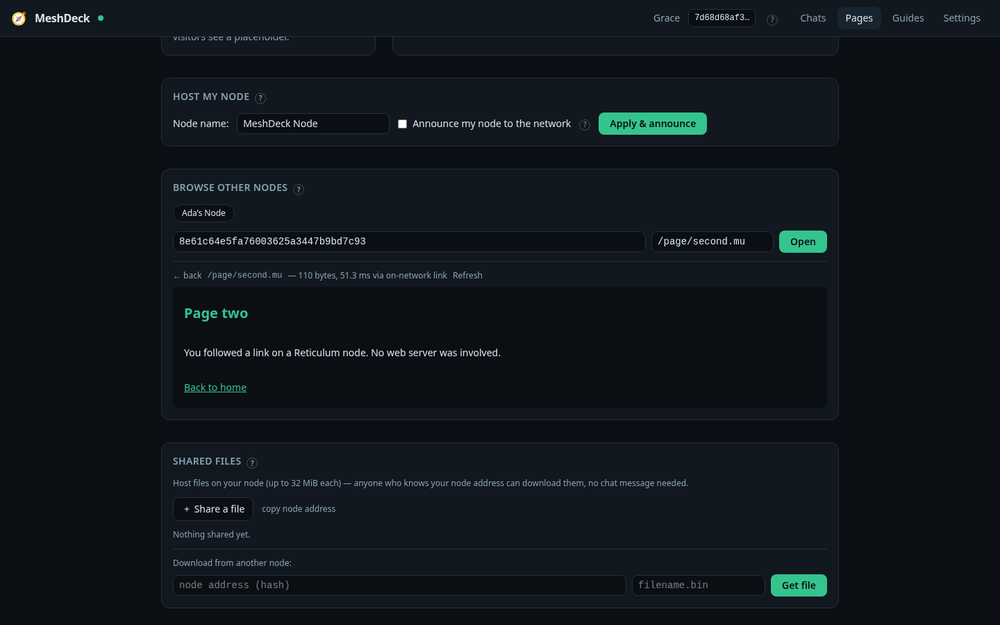
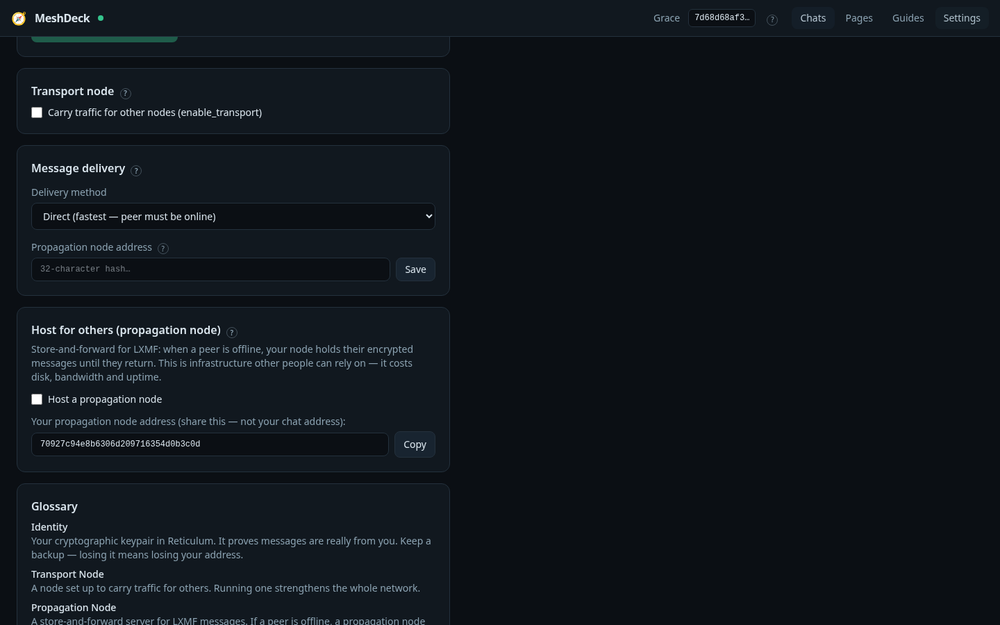

# MeshDeck

[](https://github.com/martintondel02/meshdeck/actions/workflows/ci.yml)
[](https://github.com/martintondel02/meshdeck/releases)

> A local-first Reticulum application: encrypted chat, file sharing, page hosting
> and network infrastructure behind a browser UI — with a basic mode for people
> who just want to talk, and an advanced mode for people who want the knobs.

**Status: v0.1.1 (first release series).** Chat, contacts, attachments, page hosting
and browsing with an offline cache, shared node files, transfer progress,
propagation-node hosting, the interface editor and an English-only i18n
foundation are implemented and covered by unit + integration tests. Prebuilt
Linux x86_64 artifacts (tarball and AppImage, with checksums) are attached to
the [v0.1.1 release](https://github.com/martintondel02/meshdeck/releases/tag/v0.1.1);
Flatpak remains an unverified manifest. UI and copy may still change. The live
task list is [NEXT_STEPS.md](NEXT_STEPS.md); the design record is
[BUILD_PLAN.md](BUILD_PLAN.md).

MeshDeck is free and open-source (MIT), built on the reference
[Reticulum](https://reticulum.network/) stack. It uses the official `rns` and
`lxmf` libraries rather than reimplementing the protocol: messaging speaks LXMF
and page hosting follows NomadNet's node scheme, so it can interoperate with
other clients instead of defining a new network.

One local daemon owns your identity, database and Reticulum instance. The UI is
a static web app served by that daemon to your browser on loopback. MeshDeck has
no servers of its own, no accounts and no analytics; apart from the Reticulum
traffic you configure, nothing leaves your machine.

## What you get

| Area | Basic mode | Advanced mode adds |
|---|---|---|
| Chat | 1:1 LXMF messages, delivery ticks, in-conversation search, attachments up to 1.5 MiB per message, automatic stamps when a peer requires them | Direct / opportunistic / propagated delivery and a propagation-node address |
| Contacts | Auto-discovery from announces, add by address, rename, block | — (same) |
| Pages & node | Create, edit, preview and host micron pages; browse other nodes by address, with a cached copy when a node is unreachable; share files up to 32 MiB | — (same; the Pages tab is available in both modes) |
| Interfaces | AutoInterface on by default | Editor for Auto, TCP client/server and Backbone client/server interfaces, listen address and port, gateway mode, automatic announce-rate presets for public listeners |
| Infrastructure | — | Transport-node toggle; propagation-node hosting with a configurable disk cap and usage display |
| Network status | Connected state, interface count, "announce now" | Live interface table (type, online, bitrate), config pre-flight before a restart, glossary |
| Help | Built-in Guides tab and inline tooltips | Same, plus a technical glossary |

Advanced mode is a display filter, not a security boundary. File-size caps and
page validation are enforced by the backend in both modes. The 512 KiB renderer
cap protects the browser from oversized pages.

## Screenshots

Real captures from two throwaway daemons (no mocked-up UI):

| | |
|---|---|
|  |  |
|  |  |

The capture recipe and privacy rules live in
[docs/screenshots/README.md](docs/screenshots/README.md).

## Quick start

Prerequisites: Python 3.11 or newer, Node 22 with pnpm 10 (what CI uses), and
GNU make. `make install` creates `.venv/` and installs the backend with its dev
dependencies; it does not need a system `pip`.

```bash
git clone https://github.com/martintondel02/meshdeck.git
cd meshdeck
make install            # .venv + backend with dev deps
make install-frontend   # pnpm install (once per checkout)
make dev                # build the UI, start the daemon, print the URL
```

On a checkout that already has the frontend dependencies installed,
`make install && make dev` is enough.

`make dev` prints a URL like `http://127.0.0.1:8570/?token=…`. Open it: the
token is what authenticates the UI to the local API, and the same value is
stored in `<data-dir>/token`. On first run MeshDeck creates a Reticulum
identity in its data directory — there is no signup. The default data directory
is `${XDG_DATA_HOME:-~/.local/share}/meshdeck`; `--data-dir` overrides it.

To try two identities at once, start a second isolated instance:

```bash
.venv/bin/python -m meshdeck --data-dir /tmp/meshdeck-b --port 8571
```

Each instance gets its own identity, database and Reticulum config. Use the
address from one instance's Settings screen in the other's "add peer" field.

### Or download a release binary

The [v0.1.1 release](https://github.com/martintondel02/meshdeck/releases/tag/v0.1.1)
ships three Linux x86_64 artifacts, with `SHA256SUMS`:

- `meshdeck-0.1.1-x86_64.tar.gz` — extract and run the `meshdeck` binary inside
- `meshdeck-0.1.1-x86_64.AppImage` — `chmod +x` and run it directly
- `meshdeck-0.1.1-1.x86_64.rpm` — Fedora/RHEL-family package:
  `sudo dnf install ./meshdeck-0.1.1-1.x86_64.rpm`

All three embed the web UI, so none needs Python installed. The RPM is
unsigned and, like the other binaries, built against this host's glibc; it
targets Fedora-family systems of the same architecture. Flatpak is **not**
published: the manifest in `packaging/flatpak/` has never been built
(`flatpak-builder` was unavailable), and `packaging/README.md` says so.

To build it yourself instead:

```bash
make package            # PyInstaller one-file build → dist/meshdeck
./dist/meshdeck
```

`make package` installs PyInstaller into the venv and requires the frontend
dependencies.

## How it works

```
Browser UI (Svelte 5, static assets)
      │  HTTP + WebSocket on 127.0.0.1, bearer token
      ▼
aiohttp API ──► CoreService ──┬── SQLite (data dir)
                              ├── ChatRouter (LXMF)
                              ├── PageHost (/page, /file)
                              └── RnsStack (RNS + interfaces)
                                        │
                                  Reticulum network
```

RNS and LXMF keep their own worker threads. Every callback that crosses from
those threads into the app goes through the `EventBus` bridge, and Reticulum
configuration changes are applied by re-executing the process under the CLI
supervisor. The full picture — threading rules, startup order, the EventBus,
database migrations and where to add a feature — is in
[docs/architecture.md](docs/architecture.md), with the original design in
[BUILD_PLAN.md §5](BUILD_PLAN.md#5-architecture).

## Security and privacy

- The daemon binds `127.0.0.1` by default. Every `/api/v1` request and the
  `/ws` WebSocket require a bearer token generated on first run and stored with
  mode `0600`. The UI keeps the token in `sessionStorage` and scrubs it from the
  address bar. Treat the token like a password: anyone who has it can control
  the node.
- There is no telemetry, no analytics and no phone-home. Guides ship with the
  app and work offline.
- Messages are encrypted end-to-end by RNS/LXMF. Your history, identity key and
  settings live in the local data directory; they are not uploaded anywhere.
  That directory is not encrypted by MeshDeck, so use full-disk encryption if
  that matters to you.
- Pages are untrusted content from other nodes. The micron renderer escapes page
  text, strips unknown markup and refuses pages over 512 KiB. Executable pages
  are deliberately never run.
- `--host` can bind the UI elsewhere, but there is no TLS and the token is the
  only access control. Do not expose the daemon on an untrusted network.

To report a vulnerability, follow [SECURITY.md](SECURITY.md). Please do not open
a public issue for it.

## What MeshDeck is not

- **Not a cloud service or an account system.** No signup, no sync between
  devices, no server-side history. Delete the data directory and the identity is
  gone.
- **Not a new protocol.** It does not reimplement RNS or LXMF, and it is not a
  fork of NomadNet. It is an application on top of the official stack.
- **Not an anonymity tool.** Reticulum encrypts and authenticates traffic; it
  does not hide that a node exists or when it announces.
- **Not a native desktop or mobile app yet.** It is a browser UI plus a local
  daemon. The release artifacts are Linux x86_64 only; no Flatpak or Android
  build is published.
- **Not a companion to your system `rnsd`.** MeshDeck runs its own Reticulum
  instance with `share_instance = No` and never touches `~/.reticulum`.
- **Not a full NomadNet clone.** Pages are static micron; there are no
  executable pages and no inline image/media rendering. Share images as node
  files or chat attachments.

## Development

```bash
make test              # backend unit tests (fast, no network)
make test-frontend     # vitest (micron renderer)
make test-integration  # real RNS nodes; takes minutes
make lint              # ruff + svelte-check
make check             # unit + frontend tests + lint
```

See [CONTRIBUTING.md](CONTRIBUTING.md) for setup, test details, commit style and
where copy and guides live. Architecture is in
[docs/architecture.md](docs/architecture.md); known traps are listed in
[BUILD_PLAN.md §14](BUILD_PLAN.md#14-pitfalls-learned-from-ecosystem-code--manual-reread-before-phases).

## License

MeshDeck's own code is MIT — see [LICENSE](LICENSE). Reticulum and LXMF are
Copyright (c) Mark Qvist and others and are distributed under their own
licenses. Using them as libraries does not change MeshDeck's license, but
redistributing them — for example inside the packaged binary — must follow their
terms.

## Acknowledgements

- [Mark Qvist](https://github.com/markqvist) — Reticulum, LXMF and NomadNet.
- [Liam Cottle](https://github.com/liamcottle) — original MeshChat.
- [Quad4 Software](https://github.com/Quad4-Software) — MeshChatX, a reference
  for modern Reticulum client design and protocol integration.
